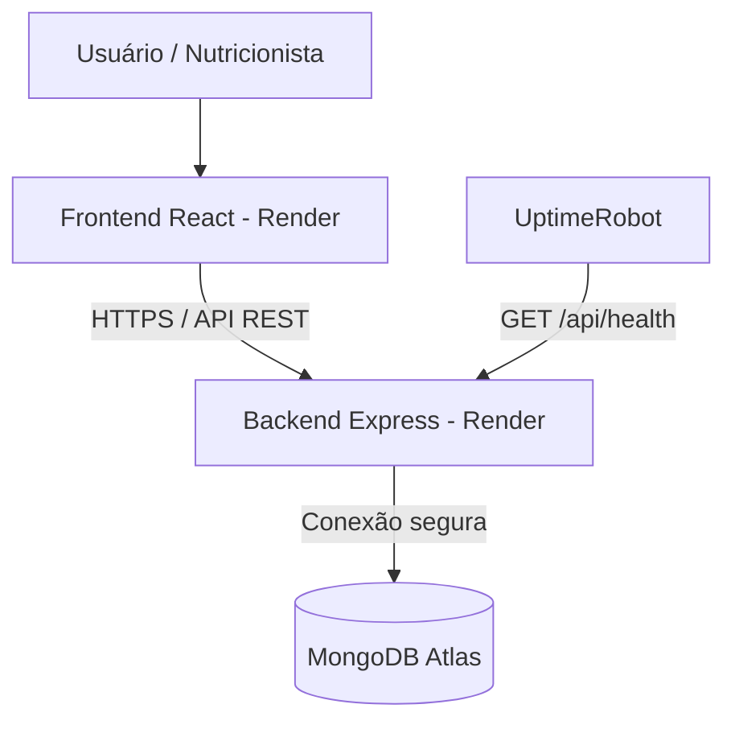
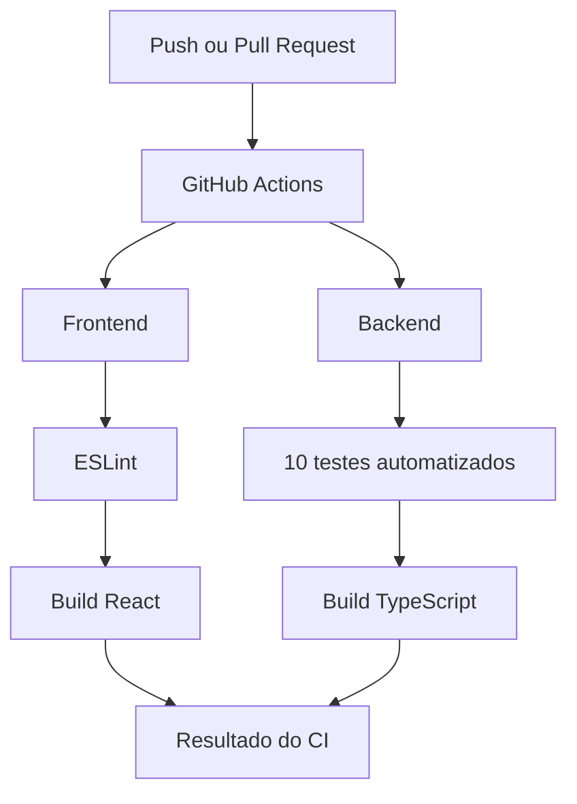
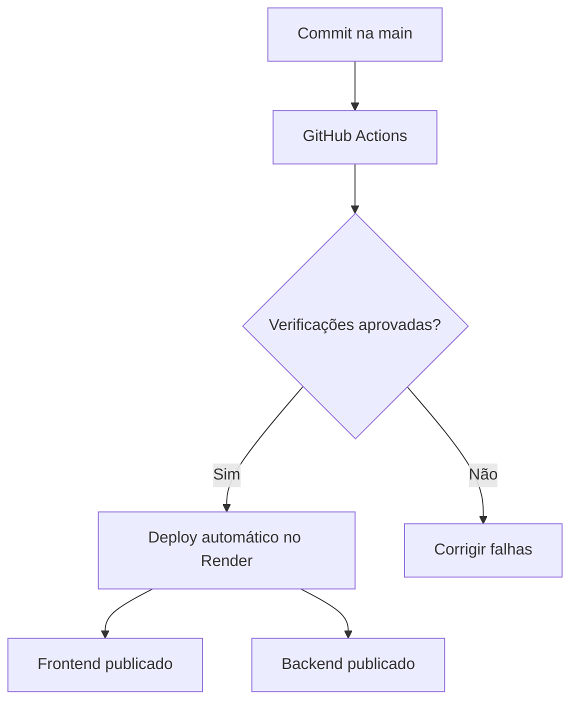

# DevOps — RotuScan Web

## 1. Visão geral

O RotuScan é uma aplicação voltada ao acompanhamento de pacientes com alergias e intolerâncias alimentares, permitindo que nutricionistas consultem informações dos pacientes, históricos de scans e indicadores gerais.

A estratégia DevOps do projeto utiliza integração contínua, entrega contínua, monitoramento e documentação da infraestrutura, com o objetivo de aumentar a confiabilidade das atualizações.

## 2. Tecnologias e infraestrutura

| Camada | Tecnologia | Finalidade |
|---|---|---|
| Frontend | React, TypeScript e Vite | Interface web do nutricionista |
| Backend | Node.js, Express e TypeScript | API REST |
| Banco de dados | MongoDB Atlas | Persistência dos dados |
| Versionamento | Git e GitHub | Controle de versões |
| Integração contínua | GitHub Actions | Testes, lint e builds |
| Hospedagem | Render | Publicação do frontend e backend |
| Monitoramento | Render e UptimeRobot | Logs, métricas e disponibilidade |

## 3. Arquitetura da aplicação

O frontend e o backend são hospedados em serviços separados no Render. O frontend realiza requisições à API REST, responsável pelas regras de negócio e pelo acesso ao MongoDB Atlas.

## 4. Integração contínua — CI

O GitHub Actions executa automaticamente as verificações quando alterações são enviadas à branch `main` ou quando são abertas pull requests direcionadas a ela.

### Frontend

1. Checkout do repositório.
2. Configuração do Node.js 24.
3. Instalação das dependências com `npm ci`.
4. Análise estática com `npm run lint`.
5. Compilação com `npm run build`.

### Backend

1. Checkout do repositório.
2. Configuração do Node.js 24.
3. Instalação das dependências com `npm ci`.
4. Execução de testes com `npm test`.
5. Compilação TypeScript com `npm run build`.

O backend possui 10 testes automatizados para validações relacionadas à autenticação.

### Fluxo CI

## 5. Entrega contínua — CD

O frontend e o backend estão hospedados no Render, com a opção **After CI Checks Pass** configurada.

O fluxo foi testado por meio de um commit enviado à branch `main`. Após a aprovação das verificações do GitHub Actions, os serviços realizaram o deploy com sucesso.

## 6. Monitoramento e observabilidade

### 6.1 Health Check

O backend disponibiliza o endpoint:

`GET https://rotuscan-api.onrender.com/api/health`

A resposta contém:

- `status`: estado da API.
- `servico`: identificação do backend.
- `timestamp`: data e horário da consulta.
- `uptime`: tempo de execução do processo em segundos.

O Health Check confirma que o processo HTTP está respondendo. Ele não verifica diretamente a saúde do MongoDB.

### 6.2 Logs

Os logs do Render permitem acompanhar a inicialização da aplicação, a conexão com o MongoDB Atlas e possíveis falhas de execução.

Na verificação realizada em 03/11/2026, os logs confirmaram a conexão com o MongoDB Atlas, a inicialização do servidor e a publicação bem-sucedida do serviço.

### 6.3 Métricas de infraestrutura

O Render disponibiliza métricas de tráfego de rede, CPU e memória, conforme os recursos disponíveis no serviço.

Na inspeção realizada, foram identificados:

- Limite de memória: 512 MB.
- Limite de CPU: 0,15 CPU.
- Tráfego de saída mensal exibido: 1 MB.

Os gráficos de CPU e memória não apresentavam leituras visíveis na captura analisada.

### 6.4 Monitoramento externo

O UptimeRobot realiza verificações HTTP no endpoint `/api/health`, com intervalo configurado de 5 minutos.

Na primeira verificação apresentada:

| Indicador | Resultado |
|---|---|
| Status | Up |
| Disponibilidade exibida | 100% |
| Incidentes registrados | 0 |
| Tempo de resposta observado | 252 ms |
| Intervalo de verificação | 5 minutos |

Esses resultados representam o início do monitoramento e não comprovam disponibilidade histórica de 7 ou 30 dias.

## 7. Indicadores e objetivos de serviço

Os indicadores utilizados para acompanhar a qualidade operacional incluem:

| Indicador | Objetivo |
|---|---|
| Disponibilidade | Acompanhar a proporção de verificações bem-sucedidas |
| Tempo de resposta | Acompanhar a latência do Health Check |
| Incidentes | Registrar períodos de indisponibilidade |
| Saúde da API | Confirmar respostas HTTP bem-sucedidas |
| Logs | Identificar erros de execução e implantação |

Como objetivo inicial de disponibilidade, propõe-se **99,5% ao mês**, sujeito à avaliação após a coleta de um período representativo de dados.

Esse percentual é uma meta interna proposta, não uma garantia contratual de SLA nem um resultado já alcançado.

## 8. Segurança e boas práticas

O projeto utiliza autenticação por JWT, senhas protegidas por hash, comunicação HTTPS nos serviços publicados e configuração de origens permitidas por CORS.

As credenciais de banco de dados e demais segredos devem permanecer em variáveis de ambiente, fora do repositório.

As verificações automatizadas reduzem o risco de publicar código com erros de compilação ou problemas identificados pelos testes existentes. Elas não substituem testes de integração, auditorias de segurança ou monitoramento contínuo.

## 9. Melhorias futuras

- Ampliar a cobertura de testes automatizados.
- Criar testes de integração para as rotas da API.
- Registrar métricas de latência e erros HTTP por endpoint.
- Configurar notificações de incidentes.
- Acompanhar a disponibilidade durante períodos maiores.
- Estabelecer procedimentos de recuperação e rollback.

## 10. Conclusão

O RotuScan possui um fluxo de CI/CD implementado e testado, utilizando GitHub Actions e Render. O backend dispõe de Health Check, logs de execução e monitoramento externo por meio do UptimeRobot.

A infraestrutura atual atende às necessidades do projeto acadêmico sem exigir a utilização de contêineres Docker.
